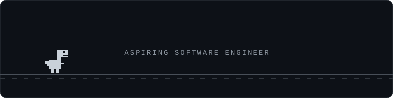

  

##

I'm a second year B.Tech Computer Science student at **JIS College of Engineering, Kalyani**. I love building and designing things, from clean interfaces to intelligent systems that actually do something useful. I'm especially drawn to **AI agents**, **retrieval-augmented generation (RAG)**, and **large language models**.

## 🎯 Currently Focusing On

- 🧩 Data Structures & Algorithms
- 🤖 Building with LLMs and AI agents
- 📚 RAG systems: embeddings, vector search, chunking, retrieval quality

## 🛠️ Tech Stack

  
  
  
  
  
  
  
  
  

## 🚀 Projects

| Project | Description |
|---|---|
| **[VARUNA](https://github.com/npcenergydev/VARUNA)** | Vision-based oil spill detection and vessel attribution (Smart India Hackathon 2026) |
| **[YappChat](https://github.com/npcenergydev/Yapp)** | A Cafe themed real time messaging and media sharing platform |
| **ATLAS: Agentic RAG** 🚧 | Agentic RAG system, currently under development |

## 🌱 Learning

- Advanced DSA and problem-solving patterns
- LLM application design, agents and tool use
- Building reliable RAG pipelines

## 📊 GitHub Stats

  
  

## 🐍 Contribution Snake

  <picture>
    <source media="(prefers-color-scheme: dark)" srcset="https://raw.githubusercontent.com/npcenergydev/npcenergydev/output/github-contribution-grid-snake-dark.svg">
    <source media="(prefers-color-scheme: light)" srcset="https://raw.githubusercontent.com/npcenergydev/npcenergydev/output/github-contribution-grid-snake.svg">
    
  </picture>

## 📫 Let's Connect

---

<i>"Build things, break things, learn things."</i>

